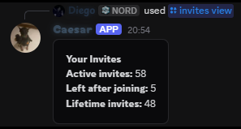

## View statistics

Use `/invites view` to see your invite totals. Choose another member to view their statistics if you have access. The summary distinguishes current invites, invited members who later left, and lifetime invites.

<CodeGroup>

```javascript Syntax
/invites view user:<user>
```

```javascript Example
/invites view user:hvurs
```

<br />
<Frame>
  
</Frame>
<br />

</CodeGroup>

## Manage invites

Authorized staff can run `/invites admin` to open the invite management panel. It can adjust a member's invite count and open the detective view for invite activity.

The detective view brings together the member's invite links and recorded invite activity, including join events where Caesar has tracking data. Discord may not provide complete historical information for links created before tracking began.
