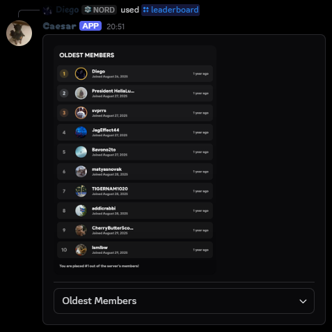
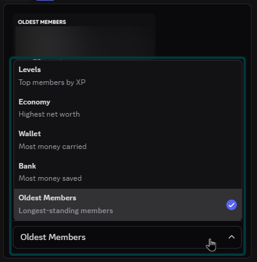

Use `/leaderboard` and select the `board` option:

| Board          | Ranking           |
| -------------- | ----------------- |
| Levels         | Member levels     |
| Net Worth      | Economy net worth |
| Wallet         | Wallet balance    |
| Bank           | Bank balance      |
| Oldest Members | Account age       |

The board is optional; Discord displays the available choices in the command picker. Some boards require economy or member data to be available.

## Example Usage

<CodeGroup>
```javascript Syntax
/leaderboard board:<option>
```

```javascript Example
/leaderboard board:Oldest Members
```

</CodeGroup>

<br />
<Frame>
  
</Frame>
<br />
<br />
<Frame>
  
</Frame>
<br />
