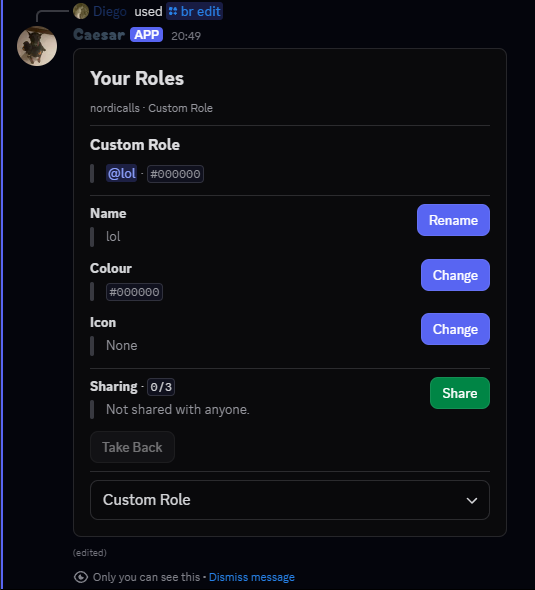

Run `/br edit` to open your role panel. It contains pages for your booster role, custom role, roles shared with you, and help.

 
<Frame>
  
</Frame>
 

## Booster roles

You must be actively boosting the server to create or edit a booster role. Each member can have one. Use the panel to create it, change its name or colour, set an icon, share it, or delete it. Your booster role is removed when you stop boosting.

Role icons require the server to have Boost Level 2. Discord accepts an uploaded image, an image link, or a standard emoji; custom server emoji are not accepted as role icons.

## Custom roles

Custom roles are obtained from the shop or granted by staff; they do not require a server boost. Use `/br edit` to edit the custom role you own, including its name, colour, and sharing.

## Sharing a role

The panel shows the number of people you can share with and who currently has the role. Choose a member to send them an accept-or-decline request. You can unshare it later; deleting a booster role or revoking a staff-granted custom role removes it from everyone it was shared with.

Default share limits are five people for a booster role and three for a custom role. Staff can change an individual member's limit in `/br admin`; lowering a limit does not remove existing shares.

## Staff management

`/br admin` lets authorized staff look up a member, grant or revoke a staff-managed custom role, change sharing limits, delete a member's booster role, and clean up roles belonging to people who left the server. Shop-bought custom roles cannot be revoked from this panel. Staff access requires the configured `br_admin` permission; the bot also needs **Manage Roles** and a role position above the roles it manages.
