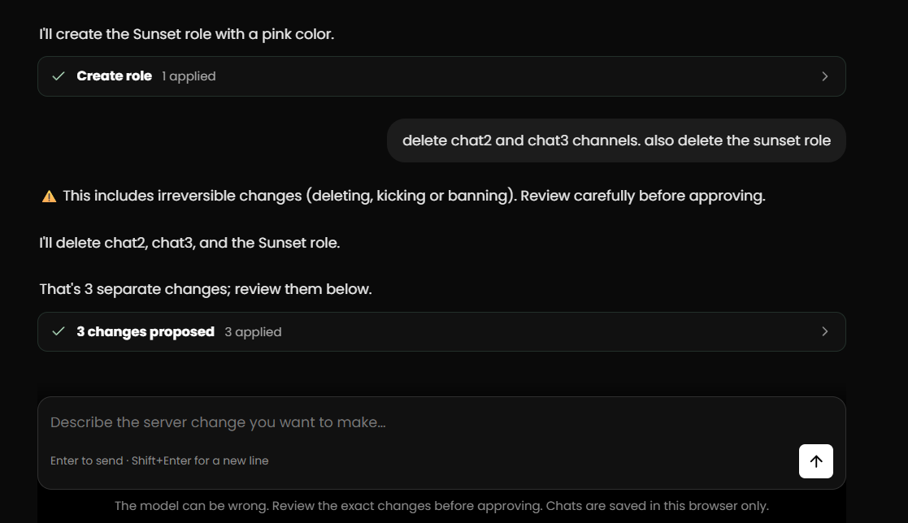

Open the [Nordicalls Dashboard](https://dash.hvurs.cc) and sign in with Discord. Permissions are synced from your discord roles!

The AI Builder can be found under **"Server AI"** on the dashboard. With the AI builder, you have unlimited chats, and a local chat history, based off of your conversations with the AI.
Every chat you send can add/remove/change something within the Nordicalls discord server, such as creating a channel, giving X role access to a channel, and much more.

You have to approve each change yourself, otherwise the bot will not make any changes.

 
<Frame>
  
</Frame>
 

## Abilities

The bot can do pretty much anything, except manage the bot itself (such as changing who can access X command). Gradient roles/adding role icons is currently not supported by the bot, as it struggles with hex-codes.
