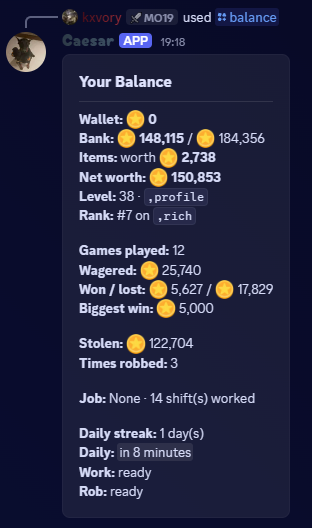
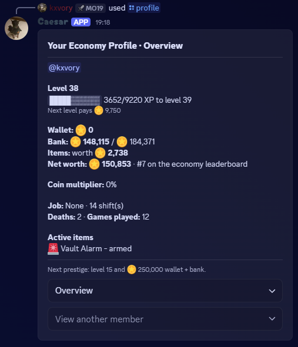
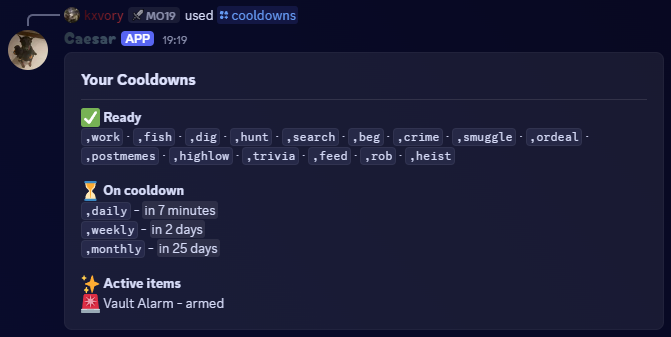
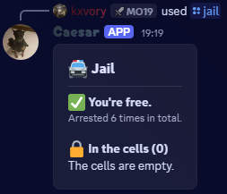
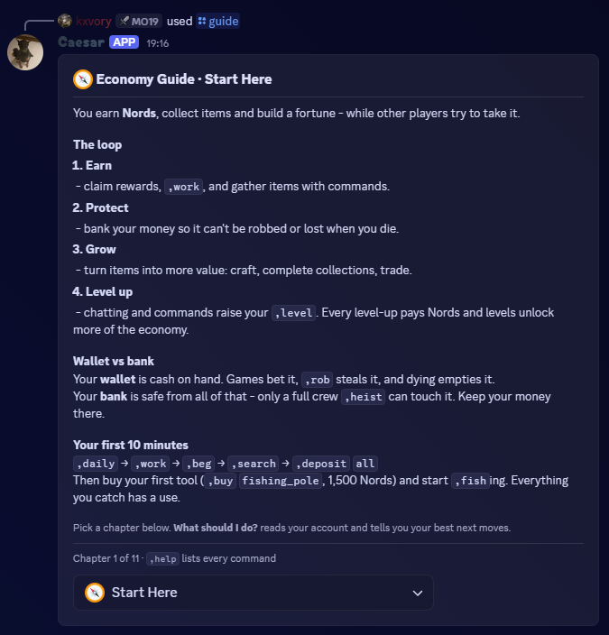
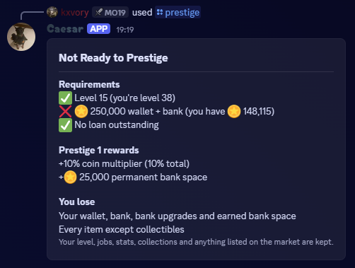
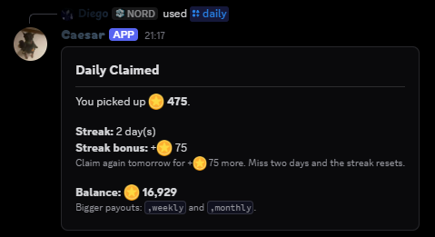
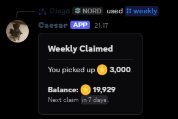
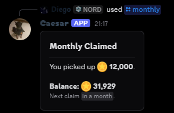
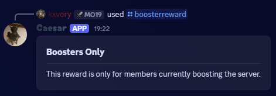

Most economy commands are available to everyone. Some features unlock at higher levels, and cooldowns, debt, jail, or item requirements can limit individual actions.

## Account and progress

### `/balance`

View your wallet, bank balance, net worth, rank, job, and active cooldowns. You can include a member to view their public economy summary. Only wallet money can be taken by `/rob`.

 
<Frame>
  
</Frame>
 

### `/profile`

Open an economy profile panel for yourself or a selected member. Use its selectors to view the overview, active cooldowns, job, jail status, and notification settings. Each section shows the information it names.

 
<Frame>
  
</Frame>
 

### `/cooldowns`

See which activities are ready and which are waiting on a cooldown. Active item effects are shown as well.

 
<Frame>
  
</Frame>
 

### `/jail`

Check your jail status and see who is currently jailed. Arrests from crime, robbery, or heists temporarily prevent more crimes, robberies, and heists; legal activities remain available.

 
<Frame>
  
</Frame>
 

### `/guide`

Browse the economy guide by chapter, or choose **What should I do?** for suggestions based on your account.

 
<Frame>
  
</Frame>
 

### `/prestige`

View the requirements for prestige or reset when eligible. Prestiging resets your wallet, bank, and most non-collectible items, but keeps your level. Each prestige grants a permanent coin multiplier and more bank capacity. Requirements increase each time, up to the configured prestige limit. Review the confirmation carefully before accepting.

 
<Frame>
  
</Frame>
 

## Payouts and work

### `/daily`

Claim your daily payout. Claim on consecutive days to build a streak; missing a day resets it.

 
<Frame>
  
</Frame>
 

### `/weekly`

Claim the weekly payout when its cooldown is ready.

 
<Frame>
  
</Frame>
 

### `/monthly`

Claim the monthly payout. This reward has a 30-day cooldown.

 
<Frame>
  
</Frame>
 

### `/boosterreward`

If you are actively boosting the server and have not claimed the one-time booster reward before, use this to claim it. Stopping and restarting a boost does not make the reward claimable again.

This is separate from ongoing [booster economy perks](/economy/boosters).

 
<Frame>
  
</Frame>
 

### `/work`

Work one shift for your current job; shifts have an hourly cooldown. Each shift includes a short minigame; a successful result earns full pay, while a failed or timed-out result earns less. Pay and possible item drops depend on your job.

### `/jobs`

View available jobs, requirements, and pay. Choose `apply` and an unlocked job to take it, or choose `quit` to return to odd jobs. Quitting is free; changing jobs has a 12-hour cooldown.

## Wallet and bank

### `/bank`

View your bank balance and capacity. The bank protects money from robbery and death, but a successful full heist can still take it.

### `/bank deposit`

Move money from your wallet into the bank. Enter an amount or `all` to deposit as much as the remaining capacity allows.

### `/bank withdraw`

Move money from your bank into your wallet. Enter an amount or `all`; wallet money can be targeted by robbery.

### `/pay`

Send money from your wallet to another member. A transfer tax is charged, except between trusted members of the same organisation.

### `/gift`

Give an item from your inventory to another member. Gifts use the transfer tax based on the item's shop value; trusted members of the same organisation do not pay that tax.

### `/loan`

View your borrowing limit and current loan. Loans unlock at level 3. Choose `take` to borrow or `repay` to pay it back. Interest is due within the loan term; late fees accrue afterward and the bank collects available funds until the debt is paid. You can only have one loan at a time, and outstanding debt blocks prestige, `/pay`, and `/gift`.

### `/notifications`

View your economy direct-message setting or choose `on`/`off` to change it. Notifications are on by default and can report robberies, heists, payments, market sales, returned expeditions, and staff account changes.
