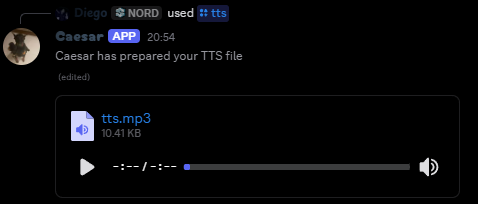

Use `/tts text:<text>` to have Caesar read text aloud and attach an MP3 to its reply.

<CodeGroup>

```javascript Syntax
/tts text:<text>
```

```javascript Example
/tts text:Hello World
```

</CodeGroup>

The text field accepts up to 300 characters by default. Links, mentions, custom emoji, and code formatting are removed before speech synthesis. The command has a short per-user cooldown.

`/tts` has no command-specific staff permission gate in the current command implementation. If it does not appear or run in your server, check the bot's slash-command access and ask a server administrator.

<br />
<Frame>
  
</Frame>
<br />
